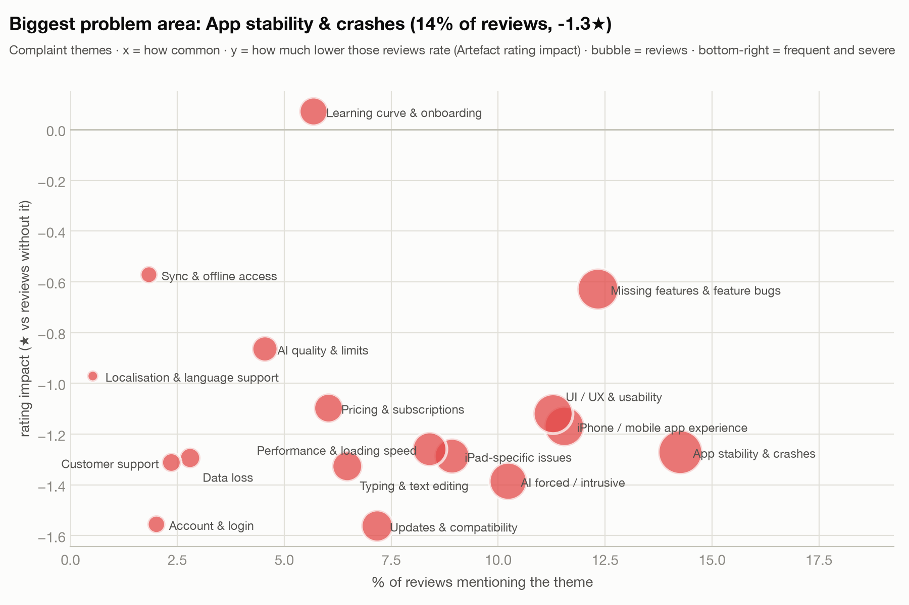

# App Store Review Analysis API

A REST API that collects Apple App Store reviews for any app, cleans them, and returns metrics and
NLP insights:
- rating metrics with confidence intervals;
- sentiment, and complaints hidden inside positive reviews;
- the phrases that set negative reviews apart, and rating drivers;
- complaint and praise themes, a ranked list of the biggest problem areas with verbatim quotes, and what
  changed recently.

Raw reviews download as CSV or JSON, and every collection has an HTML report with charts.
Everything runs offline on free, open models. No paid API is called at any point.

**Deliverables**

| | |
|---|---|
| **Sample report** (Notion, 1,143 reviews) | [`reports/REPORT.md`](reports/REPORT.md) |
| **Interactive HTML reports** | **https://senyyaw.github.io/reviews_analysis/** (GitHub Pages, built from [`docs/`](docs/)) |
| **Charts** | 13 PNGs in [`reports/figures/`](reports/figures/) |
| **Live run on a second app** | Nebula: 100 random reviews collected through the API on 2026-10-14 ([report appendix](reports/REPORT.md#appendix-the-same-api-on-a-new-app-nebula-live-run), `data/snapshots/nebula_2026-10-14`) |
| **Live API** (read-only, Vercel) | **https://reviews-analysis-ten.vercel.app/docs**. For example: [insights](https://reviews-analysis-ten.vercel.app/v1/collections/notion_2026-10-13.pool/insights), [HTML report](https://reviews-analysis-ten.vercel.app/v1/collections/notion_2026-10-13.pool/report), [CSV](https://reviews-analysis-ten.vercel.app/v1/collections/notion_2026-10-13.A_random/reviews?format=csv) |

## The brief, and where each requirement is met

| Requirement | Implementation |
|---|---|
| Collect 100 random reviews for a specified app, with error handling | `POST /v1/apps/{app_id}/collections` (default body: 100 random reviews, seed 42). [Collection](#1-data-collection) covers the seeded random sample, input validation, backoff on throttling, a time budget and partial data with warnings. |
| Extract title, text and rating; clean the text | [Processing](#2-processing): repair-only normalisation, language ID, a separate lemma track for keywords, deduplication, and translation of non-English reviews for keywords |
| Average rating and rating distribution | `GET /v1/collections/{id}/metrics`: mean with a 95% CI (finite-population corrected), % per star with Wilson CIs, plus a check that the sample is representative |
| Sentiment (positive / negative / neutral) | Fine-tuned RoBERTa / XLM-R, evaluated against human labels: macro-F1 0.78, negative recall 0.95 ([evaluation](#4-sentiment)) |
| Keywords and phrases in negative reviews | Fightin' Words (Monroe et al. 2008) against a background of 14 other apps, plus a rating-driver model ([keywords](#5-keywords-and-phrases-in-negative-reviews)) |
| Actionable insights / areas of improvement | Problem areas ranked by prevalence × rating drag, each with evidence and verbatim quotes, a recent-vs-earlier comparison and a drift monitor ([insights](#6-actionable-insights-themes-and-ranked-problem-areas)) |
| REST API: collect, metrics + insights, raw-data download | [API reference](#api) |
| README and sample report | This file and [`reports/REPORT.md`](reports/REPORT.md) |
| Bonus: visualisations | 13 static charts plus an interactive HTML report per collection (`/report`) |
| Bonus: cloud deployment | Vercel (free Hobby plan) for the API, GitHub Pages for the reports, and Docker for anywhere ([deployment](#deployment)) |

## Results for Notion (from the sample report)



- **Ratings.** Written reviews average 3.13★ [3.03, 3.23], against 4.78★ on the listing. The 100 most
  recent average **2.54★**, and the share of 1–2★ reviews rose from 27% (June) to 47–64%
  (August–October).
- **Complaints.** **65%** of reviews contain a complaint, including **89% of 4★ reviews**.
- **Biggest problem areas:**

  | Theme | Reviews | Rating drag |
  |---|---|---|
  | App stability & crashes | 14% | −1.3★ |
  | AI forced / intrusive | 10% | −1.4★ |
  | iPhone app gaps | 12% | −1.2★ |
  | UI/UX | 11% | −1.1★ |
  | iPad | 9% | −1.3★ |

- **Emerging.** Typing & text-editing complaints went from **6% to 15%** in the latest seven weeks
  (q = 0.01 against the earlier year).
- **Keep.** Versatility (22%, +1.8★) and organisation (18%, +1.9★).

## Quick start

Requirements: Python 3.12, [uv](https://docs.astral.sh/uv/) and [Git LFS](https://git-lfs.com) (the
three ONNX models, about 690 MB, are stored in LFS).

```bash
git clone https://github.com/senyyaw/reviews_analysis.git && cd reviews_analysis
git lfs pull                       # the models; without them, serving cached results still works
uv sync --extra nlp                # API + NLP stack (spaCy, lingua, onnxruntime, scikit-learn)
uv run review-analysis serve       # http://127.0.0.1:8000/docs
```

`uv sync` without `--extra nlp` installs only what the API needs to **serve** analysed snapshots
(about 110 MB, the read-only deployment). Collecting and analysing new reviews needs the `nlp` extra.

### Try it

The Notion and Nebula snapshots are committed, so these work immediately:

```bash
curl localhost:8000/v1/collections                                     # Notion: pool, A_random, B_recent; Nebula: pool, random_100_s42
curl localhost:8000/v1/collections/notion_2026-10-13.A_random/metrics
curl localhost:8000/v1/collections/notion_2026-10-13.A_random/insights
curl -OJ "localhost:8000/v1/collections/notion_2026-10-13.A_random/reviews?format=csv"
open  localhost:8000/v1/collections/notion_2026-10-13.pool/report       # HTML report with charts
curl "localhost:8000/v1/compare?base=notion_2026-10-13.pool&target=notion_2026-10-13.B_recent"
```

To collect **100 random reviews** for any app, use its App Store id. For example, Nebula is
1459969523:

```bash
curl -i -X POST localhost:8000/v1/apps/1459969523/collections \
     -H 'content-type: application/json' \
     -d '{"strategy": "random", "count": 100, "window_days": 90, "storefronts": ["us", "gb"]}'
# 202 Accepted, Location: /v1/jobs/<job_id>   → poll it:
curl localhost:8000/v1/jobs/<job_id>        # state, progress, then collection_ids
curl localhost:8000/v1/collections/<collection_id>/insights
```

How long a collection takes:
- The job downloads every review in the window (at most 60 pages of 20 per storefront), draws the
  sample, and then runs preprocessing, sentiment and themes.
- It usually takes a few minutes, because the client waits ≥ 3 s between requests and backs off for
  minutes when Apple throttles (HTTP 429).

### Docker

```bash
git lfs pull
docker build -t review-analysis .
docker run -p 8000:8000 review-analysis      # full API, collection enabled
```

### Command line (the same pipeline, step by step)

```bash
uv run review-analysis collect --app-id 1232780281 --random-n 300 --out data/snapshots/notion   # ~5 min
uv run review-analysis preprocess --snapshot data/snapshots/notion [--translate]  # --translate: uv sync --extra translate
uv run review-analysis analyze    --snapshot data/snapshots/notion   # sentiment + complaint, then themes
uv run --extra report review-analysis figures --snapshot data/snapshots/notion --out reports   # PNG charts
uv run review-analysis export-site --out docs                         # static HTML reports
```

### Tests and checks

```bash
uv sync --all-extras
uv run pytest            # 96 tests. Some use the real ONNX models (skipped without git lfs pull).
uv run mypy && uv run ruff check src tests research
```

The API tests run a real collection job against a simulated App Store (respx). That covers
pagination, throttling, every endpoint, the CSV download, the problem+json errors, and an HTML
escaping test for review text in the report.

## API

Interactive docs are at `/docs` and the OpenAPI schema is at `/openapi.json`. A collection id is
`<snapshot>.<sample>`, for example `notion_2026-10-13.A_random`. Every snapshot also has a `.pool`
collection: every review in its window.

| Method | Path | What it returns |
|---|---|---|
| GET | `/health`, `/ready` | Liveness; readiness (collection count, whether collection is enabled) |
| GET | `/v1/apps/{app_id}?storefront=us` | App lookup: name, seller, listing rating. **404** for an unknown app |
| POST | `/v1/apps/{app_id}/collections` | Starts a collection job. **202** with `Location: /v1/jobs/{id}`. Body (all optional): `strategy` `random`\|`recent`, `count` 1–1000 (default 100), `window_days` 1–1095 (default 365), `storefronts` (ISO codes), `seed` |
| GET | `/v1/jobs/{job_id}` | Job state (`queued`/`running`/`done`/`failed`), progress messages, `collection_ids`, error |
| GET | `/v1/collections` and `/v1/collections/{id}` | Collections: parameters, sizes, window, warnings, links |
| GET | `/v1/collections/{id}/reviews` | **Raw data download.** `?format=json\|csv`, `include_analysis` (language, translation, sentiment, complaint), filters `rating`, `sentiment`, `lang`, plus `limit`/`offset`. The CSV is streamed with a filename. Usernames are never stored, only a pseudonymous `author_hash` |
| GET | `/v1/collections/{id}/metrics` | n, mean rating with a 95% CI (FPC for random samples), median, % per star with Wilson CIs, by storefront, by month, listing vs written, representativeness (random samples), stars × text sentiment |
| GET | `/v1/collections/{id}/insights` | Sentiment and complaint shares with CIs, most-mentioned aspects with tone, distinctive phrases of negative reviews, rating drivers, themes (prevalence, rating impact, quotes), **improvement areas**, drift monitor, notes |
| GET | `/v1/collections/{id}/report` | The metrics and insights as an HTML report with interactive charts |
| GET | `/v1/compare?base=&target=` | Emerging, fading and persistent themes (two-proportion tests, Benjamini–Hochberg), plus taxonomy-free rising phrases |

**Errors** follow RFC 9457 (`application/problem+json`, with `title`, `status`, `detail` and
`instance`):

| Status | When |
|---|---|
| 404 | Unknown app, collection or job |
| 422 | Invalid input: a malformed id, `count` out of range, an unknown storefront, or comparing two snapshots |
| 409 | Not analysed yet, or no earlier reviews to compare |
| 502 | App Store unavailable after retries (the job reports `failed`) |
| 503 | Collection disabled on read-only hosting, or the `nlp` extra is missing |

More cases:
- **Fewer reviews than requested**, or a storefront throttled until retries ran out: the job keeps
  what it has and records a warning on the collection.
- **Small collections:** phrases and drivers say why they are unavailable (they need ≥ 20 and ≥ 30
  reviews per side) instead of returning noise.

Results are computed on the first request and cached next to the snapshot
(`<snapshot>/cache/*.v1.json`). That is how a read-only host can serve them.

## Approach

The pipeline is **collect → snapshot → preprocess → sentiment → keywords / drivers → themes →
insights → API / report**. It is shared by the API job and the CLI.

Each step was chosen by comparing options on evidence:
- research articles;
- a model comparison with a pre-registered decision rule;
- human-labelled test data.

The reasoning is summarised below. The raw results are in [`research/results/`](research/results/).

### 1. Data collection

- **Source.** `apps.apple.com/api/apps/v1/catalog/{cc}/apps/{id}/reviews` (`platform=web`, 20 per
  page, `sort=recent`).
  - The public RSS feed has served empty cached pages since about 2026-10-08, and every scraper
    library we tested was broken.
  - The web endpoint needs no token and accepts any offset, but it throttles hard (429 "API capacity
    exceeded") and has no app-version field.
  - The iTunes Lookup API validates the app id and gives the listing rating.
- **Politeness and errors.**
  - At least 3 s between requests, plus jitter.
  - Exponential backoff (5 → 60 s, 6 retries) on 429, 5xx and timeouts, within a 30-minute budget.
  - A storefront that stays throttled stops with a warning, and the job keeps the reviews it has.
  - Raw pages are cached, so an interrupted run resumes.
  - Malformed items are skipped and counted.
  - App ids and storefronts are validated before anything is queued: an unknown app is a 404 before
    the job starts.
- **Sampling.**
  - The collector downloads **every** written review in the window (the *pool*), from up to seven
    English-speaking storefronts.
  - It then draws a **seeded simple random sample** (`random_sample`, sorted by id first, so the same
    seed gives the same sample) or takes the *most recent* reviews.
  - Downloading the pool makes the sample truly random, and lets us *verify* representativeness
    instead of assuming it.
- **Why the Notion report uses 300 + 100 rather than 100.** The brief's default of 100 random reviews
  is the API default.
  - For the report, 100 reviews give a ±0.3★ interval on the mean and cannot support a phrase or
    theme comparison. We therefore used:
    - **A** = 300 random reviews from the last 12 months (±0.17★, finite-population corrected);
    - **B** = the 100 most recent reviews;
    - the full pool of 1,143.
  - B is compared with the part of A that is *older* than B's window, so the comparison is earlier vs
    recent.
- **Privacy and terms.**
  - Usernames are replaced by a SHA-256 hash prefix (`author_hash`). The raw pages, which contain
    usernames, are git-ignored.
  - The web endpoint is undocumented and its `robots.txt` disallows `/api/`. This project uses it
    politely, for research and assessment.
  - The committed snapshot makes the analysis reproducible without calling Apple again.

### 2. Processing

Cleaning follows two tracks. A model input must keep what a tokenizer needs; a keyword input must
drop noise (Artefact 2021; Malik & Bilal 2024).

- **Shared normalisation** only ever repairs, never deletes:
  - `title + ". " + body`;
  - HTML unescaping, `ftfy` mojibake repair and NFKC;
  - invisible characters removed, while emoji sequences are kept;
  - URLs and emails become placeholders;
  - line breaks become sentence ends.
- **Track A (model input).** Case, punctuation, emoji, numbers and **negations** are kept. Tutorials
  that strip stopwords delete "not", which flips sentiment.
- **Track B (keywords).**
  - spaCy lemmas, lowercased, with a small synonym map (ipad, macos, offline…).
  - Stopwords are removed, **but negations and "too" are kept**, so "not work" survives.
  - Phrases never cross a sentence boundary.
  - *Domain stopwords* are derived from the data: words frequent in both 1–2★ and 4–5★ reviews, such
    as notion, app, use, work. They are dropped as single keywords but kept inside phrases.
- **Language.**
  - lingua language ID, restricted to 20 plausible languages, with fixes for short English text.
    "iPad. Laggy" was detected as Ganda before the fix.
  - Sentiment and themes use **multilingual models on the original text**. On Notion's 34
    non-English reviews the multilingual model scored 0.82 vs 0.18 for the English one.
  - Only the keyword track is machine-translated, because phrase counting needs one vocabulary:
    m2m100-1.2B, sentence by sentence, with a repetition block, cached.
  - Notion: 1,105 English, 34 translated, 4 undetermined.
- **Data checks.** Exact duplicates (same author and text) are removed. Near-duplicates (character
  n-gram TF-IDF ≥ 0.9) are flagged. Very short or emoji-only reviews count for ratings but not for
  keywords.

### 3. Metrics

- **Mean rating.** A t-interval. For a random sample from a known pool, the finite-population
  correction applies (300 of 1,143).
- **Shares.** Every share (per star, sentiment, theme) carries a **Wilson** 95% interval. It behaves at
  small n and near 0% or 100%, unlike the normal approximation.
- **Representativeness.** Each random sample is checked against its pool: is the pool mean inside the
  sample's CI, and does a χ² goodness-of-fit test pass on the star mix? For A it does (p = 0.94).
- **Listing vs written.** The listing (4.78★, 90k ratings, mostly without text) and the written
  reviews (3.13★) are reported side by side. People with a problem write, so text shares describe
  *reviewers*, not all users.

### 4. Sentiment

**Labels to evaluate on.** The test set (D1) is 300 Notion reviews, stratified by star rating.
- The project author labelled **100** of them blind (stars hidden), following
  [`research/labelling_guide.md`](research/labelling_guide.md). Each review got sentiment by the test
  "would they recommend it *as it is now*?", plus complaint yes/no.
- Two open-weight LLMs, run locally on GPUs, labelled all 300: Qwen3.8-27B-FP8 and
  Gemma-4-31B-FP8, with structured output, temperature 0 and pinned revisions.
- Agreement with the human labels: sentiment κ 0.81, complaint κ 0.81–0.84. The LLMs agree with each
  other at κ 0.96. This follows the LLM-as-annotator evidence of Gilardi et al. (2023), verified
  against our own human labels before use.
- A star-stratified dev set (D2, 250 reviews) was kept for tuning.

**Off-the-shelf comparison.** Pre-registered rule: best macro-F1 on the human labels; if the
difference is not significant (McNemar), take the simplest model.

| Model (D1-human, n = 100) | Macro-F1 [95% CI] | Acc | Note |
|---|---|---|---|
| VADER (lexicon) | 0.53 | 0.68 | Significantly worse (p = 0.004) |
| TF-IDF + logistic regression | 0.52 | 0.66 | Significantly worse (p = 0.001) |
| nlptown mBERT (stars) | 0.58 | 0.76 | |
| clapAI XLM-R multilingual | 0.60 | 0.78 | Best on the non-English reviews |
| cardiffnlp XLM-T | 0.61 | 0.81 | |
| **cardiffnlp twitter-RoBERTa** | **0.69** [0.57, 0.80] | 0.84 | Best deployable model |
| LLM reference (Qwen / Gemma) | 0.81 | 0.90 | Too heavy for the API |

**Fine-tuning by distillation.**
- **Data.** The two LLMs labelled 8,153 reviews of **14 other productivity apps**, never Notion. The
  6,796 reviews where they agree trained the model and 754 validated it. Hinton et al. (2015)
  describe this kind of distillation.
- **Model.** Each model learns sentiment *and* a complaint head, with 3 seeds.
- **Compared:**
  - RoBERTa-base and large;
  - DeBERTa-v3-base and large;
  - XLM-R-base and large;
  - mDeBERTa;
  - ensembles.
- **Results:**
  - The fine-tuned cardiffnlp model beats its off-the-shelf version: McNemar p = 0.003 on the LLM
    labels, and the same direction on the human labels.
  - **Bigger models and ensembles gave no significant gain** (DeBERTa-v3-large 0.762 vs 0.763), so the
    125M model was kept.
- **Shipped.** A language router:
  - English and undetermined text → fine-tuned cardiffnlp RoBERTa;
  - other languages → fine-tuned clapAI XLM-R.

  Both are exported to **int8 ONNX** with per-channel dynamic quantisation, which agrees with fp32 on
  99.2–99.7% of labels. They run on CPU with no PyTorch, one review at a time, because dynamic int8
  depends on the batch.

| Shipped models | D1-human (n = 100) | D1-LLM (n = 290) |
|---|---|---|
| Macro-F1 | **0.78** [0.61, 0.90] | 0.94 |
| Accuracy / MCC | 0.89 / 0.79 | 0.98 / 0.95 |
| Negative recall / precision | **0.95 / 0.92** | 0.98 / 0.97 |
| Complaint F1 (recall) | **0.96** (0.99) | 0.99 |

**Decision rule.** A review is negative when P(negative) ≥ 0.30, otherwise the argmax.
- Missing an unhappy user costs more than a false alarm, which is a cost-sensitive threshold (Elkan
  2001).
- Checked on LLM-labelled dev data, negative precision stays at 0.90. With star labels it looks like
  0.6 at *any* threshold, because 3–4★ reviews are full of complaints. Stars are noisy sentiment
  labels.

**Why a separate complaint head.** The human labels contain 11 complaints inside *positive* reviews.
A sentiment label cannot express them; the complaint head catches all 11.

Metrics follow Chicco & Jurman (2020) for MCC, with bootstrap CIs. Details are in
[`research/results/sentiment_bakeoff.md`](research/results/sentiment_bakeoff.md) and
[`finetune.md`](research/results/finetune.md).

### 5. Keywords and phrases in negative reviews

- **Fightin' Words** (Monroe, Colaresi & Quinn 2008):
  - weighted log-odds of a phrase in negative vs other reviews, with an informative Dirichlet prior
    from **8,153 reviews of 14 other productivity apps** plus the corpus itself;
  - document-level counts, so one long review cannot dominate;
  - phrases significant at |z| > 1.96;
  - the top-12 overlap at prior strengths 0.05 / 0.20 is 0.92 / 0.79, so the result is stable.

  Raw frequency would rank "app" first, and TF-IDF has no notion of *contrast*. Fightin' Words asks
  "what do unhappy users say that others don't?"
- **Generic sentiment words** ("terrible", "love") are removed using the VADER lexicon's strong words
  plus a short list, so the phrases name *product aspects* (Artefact 2021). Product words such as
  *crash*, *slow*, *free* and *easy* are kept on purpose.
- **Rating drivers.**
  - L2 logistic regression of 1–2★ vs 4–5★ on the phrases (C by 5-fold CV, AUC 0.91 for Notion).
  - 200 bootstrap refits; only phrases whose sign holds in ≥ 90% of them are reported, as odds ratios.
  - These are associations, not causes.
- **Most-mentioned aspects** replace a word cloud: share of reviews per aspect, split by tone. A word
  cloud shows neither size nor tone reliably.

### 6. Actionable insights: themes and ranked problem areas

- **Why not clustering.** Clustering sentence embeddings failed (silhouette 0.02–0.04), and it grouped
  sentences by *tone* rather than topic. Embeddings put "I love X" and "I hate X" close together
  (DaCosta 2026), so complaint and praise sentences are separated *first*, using the sentence-level
  sentiment and complaint scores. LDA is weak on short texts (Yan et al. 2013).
- **Building the taxonomy** follows the TopicGPT approach (Pham et al., NAACL 2024):
  1. Gemma extracted the aspects of 3,882 complaint and praise sentences.
  2. Qwen consolidated them into a draft taxonomy.
  3. **A human reviewed and edited** the draft into
     [`data/themes.json`](data/themes.json) v1.0: 17 complaint and 8 praise themes, each with a
     definition.
  4. Qwen tagged every sentence; 92% of reviews have a theme.
  5. A spot-check of 30 tagged sentences found 27 correct and 3 partly correct (none wrong). The
     verdicts are AI-reviewed and human-confirmed, in `data/labels/theme_spotcheck.jsonl`.
- **Serving without an LLM.** New collections are tagged by a *student* classifier:
  - multilingual-e5-base sentence embeddings (int8 ONNX, pooling inside the graph) plus one-vs-rest
    logistic regression with tuned thresholds;
  - trained on the Qwen labels and cross-validated by review;
  - theme prevalence comes out within 3.3 pp (complaints) and 1.1 pp (praise) of the teacher's;
  - bge-m3 was 0.01 F1 better at twice the size, so e5-base was kept.
- **Metrics per theme** (Artefact 2021):
  - prevalence (Wilson CI);
  - **rating impact** = mean stars of reviews mentioning the theme minus the rest (Welch CI);
  - **priority** = prevalence × (−impact);
  - verbatim quotes, preferring single-theme sentences from distinct reviews.
- **Areas of improvement** are the top complaint themes ranked by that priority, each with its
  evidence and two quotes. The API says *where* the problems are and how big they are, and leaves
  *what to do* to the product team. That keeps it honest (every number comes from the statistics and
  every quote is copied, so nothing is invented) and keeps it useful for any app, because no advice is
  written for one product.
- **Recent vs earlier.** Theme shares in the most recent sample are compared with earlier reviews
  using two-proportion tests and Benjamini–Hochberg correction. Each theme is labelled:
  - *emerging* or *fading*: confirmed after the correction;
  - *signal*: p < 0.05 before the correction only;
  - *persistent* or *no change*.
- **Per-app scope.** The taxonomy was built from Notion reviews, and `themes.json` records which apps
  it covers. For any other app the theme step is **skipped**, because tagging an astrology app with
  note-taking themes would be fiction. Problem areas then come from the distinctive phrases and
  drivers instead, with quotes.

### 7. Monitoring and maintaining the themes

Themes are not a one-off. New problems appear after a release, so every analysis reports two drift
signals:
1. **Unassigned complaints:** the share of complaint sentences no theme covers, with their recurring
   words and examples. For Notion it is 17%, and mostly generic ("please fix this").
2. **Emerging phrases:** phrases that rise against the earlier period, needing no taxonomy. A phrase
   must reach ≥ 3% of reviews and at least 1.5× its earlier share. For Notion: iPad 9% → 16%, text
   5% → 11%.

When either signal moves (a rising unassigned share, or a new word that recurs):
1. Re-run the TopicGPT steps on the new sentences: `research/llm_topics.py extract`, then
   `research/llm_consolidate.py`.
2. Review the draft and bump the `themes.json` version.
3. Re-tag the sentences (`llm_topics.py assign`) and retrain the student
   (`research/export_theme_model.py`).
4. Bump `CACHE_VERSION` so cached results are recomputed.

The same process builds a taxonomy for a new app.

### 8. Visualisations and the report

- **13 static charts.** Their titles state the finding, and every share shows its n and CI. The
  colour palette is validated for colour-vision deficiency. The charts follow the
  insight-per-chart style of the Artefact article.
- **An interactive HTML report per collection.** It uses Chart.js, follows the OS dark mode, has a
  data table behind each chart, and escapes review text. The same template feeds the API's
  `/report` and the static site in `docs/`.

## Key design decisions

| Decision | Why | Rejected alternative |
|---|---|---|
| Download the window's pool, then sample | Gives a true random sample, a measurable representativeness check, and lets recent be compared with earlier | Random offsets per storefront: unverifiable, and wasteful with throttling |
| Own `httpx` client against the web endpoint | RSS is broken and the scraper libraries are dead; politeness and backoff are explicit and tested | Third-party scrapers |
| Committed snapshot | Reproducible report and demo even when Apple throttles | Live calls in the demo |
| Two-track preprocessing | Models need negations and case; keywords need lemmas and no noise | One aggressive cleaning (it deletes "not") |
| Fine-tuned 125M models, int8 ONNX, CPU | Significantly better than off-the-shelf; larger models gave no gain; no GPU or PyTorch at serve time | DeBERTa-large or ensembles (no gain); an LLM at runtime (cost, latency) |
| LLMs only as offline annotators and teachers | Free, local, and validated against human labels (κ 0.81) | Paid API (kept as future work) |
| Negative at P ≥ 0.30 | Missing an unhappy user costs more than a false alarm | Argmax |
| Fightin' Words with a background of other apps | It asks for contrast, with significance and stability | Raw counts or TF-IDF of negative reviews |
| Report ranked problem areas, not advice | The data shows where the problems are; the decision belongs to the product team. Works for any app | Canned action sentences per theme (written for one product) |
| Human-approved TopicGPT taxonomy, plus a student classifier | Readable themes with actions; no LLM at runtime; maintainable | Embedding clustering (failed); LDA (weak on short text) |
| Per-app taxonomy scope | Themes from one app do not transfer | Applying Notion themes everywhere |
| Background jobs (202 + polling) | A collection takes minutes | A blocking request |
| Core vs `nlp` extra | The read-only API fits serverless limits (110 MB vs about 1.3 GB) | One heavy install everywhere |

## Deployment

All three options are free and need no credit card.

- **Vercel (API, read-only), live at https://reviews-analysis-ten.vercel.app/docs.**
  - `app.py` is the entrypoint and `vercel.json` excludes the models and research files.
  - It serves the committed snapshots and their precomputed cache. Collection returns 503, because a
    serverless function has no disk and a collection runs for minutes.
  - Setup: on [vercel.com](https://vercel.com) choose **Add New → Project → Import** this GitHub
    repo, then Deploy. FastAPI is detected automatically, no settings are needed, and Git LFS stays
    off.
  - Locally, the same install path (core dependencies only, 107 MB) was tested against every
    endpoint.
- **GitHub Pages (reports).** In repo **Settings → Pages**, set *Deploy from a branch*, `main`,
  `/docs`. The site is `docs/`, generated by `review-analysis export-site --out docs`.
- **Docker (full API, anywhere).** See the [Docker](#docker) section. The image includes the models
  and the NLP stack.

## Limitations

- **Written reviews are not all users.** They skew negative, against a listing of 4.78★. The
  storefronts are English-speaking.
- **No app version per review** on this endpoint, so changes are tracked by date, not by release.
- **Undocumented endpoint.** It is throttled and may change. Its robots.txt disallows `/api/`.
- **The test set is small.** 100 human labels give a macro-F1 CI of about ±0.15. LLM labels add 290
  more, but they come from the same family of annotator as the teacher.
- **Themes are app-specific.** The student classifier agrees with its LLM teacher at macro-F1 about
  0.6 per sentence. Prevalence is accurate to about 3 pp, which is what the insights use.
- **Associations, not causes.** Rating impact and drivers compare reviews that mention a topic with
  those that don't.
- **Small recent samples** only detect large changes; that is why changes have two levels, confirmed
  and signal.
- **Jobs are in memory.** They are lost on restart; the snapshots on disk are not.

## Future work

- An optional paid LLM layer:
  - run the taxonomy refresh automatically;
  - write grounded summaries, checked by exact quote matching;
  - route uncertain reviews to it.
- Aspect-based sentiment per theme.
- Scheduled re-collection with trend alerts on the drift signals.
- A persistent job queue.
- More human labels, especially neutral and non-English ones.

## Repository layout

```
src/review_analysis/
  http.py, sources/, collector.py, sampling.py, snapshot.py   collection: polite client, Apple endpoint, pool, samples
  preprocessing/                                              normalisation, language ID, sentences, lemmas, translation, dedupe
  metrics.py                                                  rating metrics with CIs, representativeness
  sentiment.py                                                ONNX sentiment + complaint router
  keywords.py, drivers.py                                     Fightin' Words, rating drivers
  themes.py, theme_classifier.py                              theme statistics, student classifier
  analysis.py                                                 insight blocks, improvement areas, drift monitor
  api/                                                        FastAPI app, jobs, schemas, store and cache
  report.py, templates/                                       HTML report  (viz.py: PNG charts, cli.py: commands)
data/snapshots/notion_2026-10-13/                             the Notion pool, samples, analysis outputs, cache
data/snapshots/others/                                        14 other apps: training data and keyword background
data/themes.json, data/labels/                                theme taxonomy; human, LLM and spot-check labels
models/                                                       int8 ONNX: sentiment-en, sentiment-multi, themes (Git LFS)
reports/                                                      REPORT.md (sample report), figures/, data/insights.json
docs/                                                         static HTML reports (GitHub Pages)
research/                                                     model comparison, fine-tuning, LLM labelling, themes, labelling tools, server scripts
tests/                                                        unit and API tests
app.py, vercel.json, Dockerfile                               deployment
```

## Reproducing the research

The research steps ran once and their outputs are committed, so the API does not need them. To
reproduce:
- **GPU work.** LLM labelling (`research/llm_label.py`, `llm_topics.py`, `llm_consolidate.py`) and
  fine-tuning (`research/finetune.py`) ran with vLLM and PyTorch on L40S GPUs
  (`research/server/*.sh`).
- **Model comparison and exports.** These run on a laptop:
  - `research/sentiment_bakeoff.py`
  - `eval_finetuned.py`
  - `export_onnx.py`
  - `theme_classifier.py`
  - `export_theme_model.py`
- **Labelling tools.** `research/label_tool.py` and `theme_check_tool.py` are local web pages for
  human labels.

## References

- Monroe, Colaresi & Quinn (2008). Fightin' Words: Lexical Feature Selection and Evaluation for
  Identifying the Content of Political Conflict. *Political Analysis* 16(4).
- Pham et al. (2024). TopicGPT: A Prompt-based Topic Modeling Framework. *NAACL 2024*.
- Barbieri et al. (2020). TweetEval. *Findings of EMNLP*. Loureiro et al. (2022). TimeLMs. *ACL
  demos* (cardiffnlp twitter-RoBERTa).
- Conneau et al. (2020). Unsupervised Cross-lingual Representation Learning at Scale (XLM-R). *ACL*.
- Wang et al. (2024). Multilingual E5 Text Embeddings: A Technical Report. *arXiv:2402.05672*.
- Hinton, Vinyals & Dean (2015). Distilling the Knowledge in a Neural Network. *arXiv:1503.02531*.
- Gilardi, Alizadeh & Kubli (2023). ChatGPT outperforms crowd workers for text-annotation tasks.
  *PNAS* 120(30).
- Hutto & Gilbert (2014). VADER. *ICWSM*.
- Elkan (2001). The Foundations of Cost-Sensitive Learning. *IJCAI*.
- Chicco & Jurman (2020). The advantages of the Matthews correlation coefficient. *BMC Genomics*
  21.
- Wilson (1927). Probable inference, the law of succession, and statistical inference. *JASA* 22.
  Benjamini & Hochberg (1995). Controlling the false discovery rate. *JRSS B* 57.
- Yan, Guo, Lan & Cheng (2013). A Biterm Topic Model for Short Texts. *WWW*.
- Malik & Bilal (2024). Natural language processing for analyzing online customer reviews: a survey,
  taxonomy, and open research challenges. *PeerJ Computer Science*.
- Morin (2021). Using NLP to extract quick and valuable insights from your customers' reviews.
  *Artefact* blog.
- DaCosta (2026). Comparing TF-IDF and Sentence Transformers for semantic similarity. *Medium*.
