# Notion on the App Store: what reviewers say and where the problems are

**Sample report** produced by this repository's API and pipeline. Every number below comes from
`GET /v1/collections/{id}/metrics`, `/insights`, `/v1/compare` and the charts in `reports/figures/`.
Every quote is verbatim.
- Interactive version: [`docs/`](../docs/index.html), published on GitHub Pages.
- Raw data: `GET /v1/collections/notion_2026-10-13.pool/reviews?format=csv`.

| | |
|---|---|
| App | Notion: Notes, Tasks, AI (App Store id 1232780281), Notion Labs |
| Data | **1,143** written reviews from the last 12 months (2025-10-13 to 2026-10-12), every review in the window, collected 2026-10-13 |
| Storefronts | us 760, gb 126, ca 102, in 73, au 66, nz 9, ie 7 |
| Samples | **A** = 300 random reviews (seed 42): the year. **B** = the 100 most recent (from 2026-08-25): now |
| Listing | 4.78★ from 90,377 ratings. Most of those have no text, so they are not analysed here |

## Executive summary

1. **Written reviews are polarised, and they have got worse since the summer.**
   - Reviews average **3.13★** [3.03, 3.23]: 39% are 5★ and 30% are 1★.
   - The 100 most recent average **2.54★** [2.21, 2.87], against 3.09★ for the year sample.
   - The share of 1–2★ reviews went from 27% in June to 47–64% in August–October.
2. **Stars hide most of the problems.**
   - **65%** of reviews contain a complaint.
   - That includes **89% of 4★ reviews** and 14% of 5★ reviews.
   - A "4★, but…" review is a user who would be happy if one thing were fixed.
3. **Biggest problem areas** (share of reviews × rating drag):

   | Theme | Reviews | Rating drag |
   |---|---|---|
   | App stability & crashes | 14% | −1.3★ |
   | AI forced / intrusive | 10% | −1.4★ |
   | iPhone app gaps | 12% | −1.2★ |
   | UI/UX | 11% | −1.1★ |
   | iPad | 9% | −1.3★ |

   **Updates & compatibility** has the largest drag of any theme (−1.6★).
4. **Emerging: typing & text editing.**
   - Complaints rose from **6% to 15%** of reviews in the latest 7 weeks.
   - The change is confirmed against the full earlier year (q = 0.01 after correcting for 25 themes).
   - Mentions of iPad rose from 9% to 16%.
5. **Protect what people love.**
   - Versatility (22% of reviews, +1.8★) and organisation (18%, +1.9★) carry the 5★ reviews.
   - **AI is the most-discussed topic: 21% of reviews, two-thirds of them negative.** The complaint is
     that AI is pushed into the core note-taking, more than AI being weak.
6. **Not a priority:** the learning curve.
   - It is mentioned by 6% of reviews, but those reviews rate the same as the rest (+0.07★, CI
     −0.38 to +0.52).
   - Mentioning that Notion takes time to learn does not go with a lower rating.

## 1. Ratings

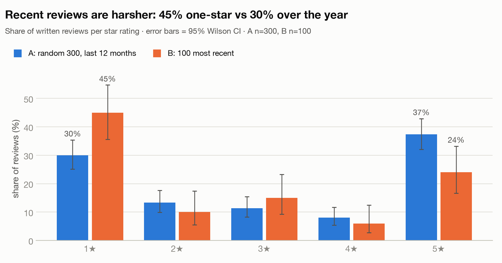

Both samples share a U-shaped distribution, but B has shifted to the left.
- 1★ reviews: 45% in B vs 30% in A.
- 5★ reviews: 24% in B vs 37% in A.

Sample A represents the pool:
- mean 3.09★ vs the pool's 3.13★;
- the pool mean lies inside A's confidence interval;
- the star mix passes a χ² test (p = 0.94), with a largest gap of 1.3 percentage points.

So conclusions drawn from A hold for all 12 months.

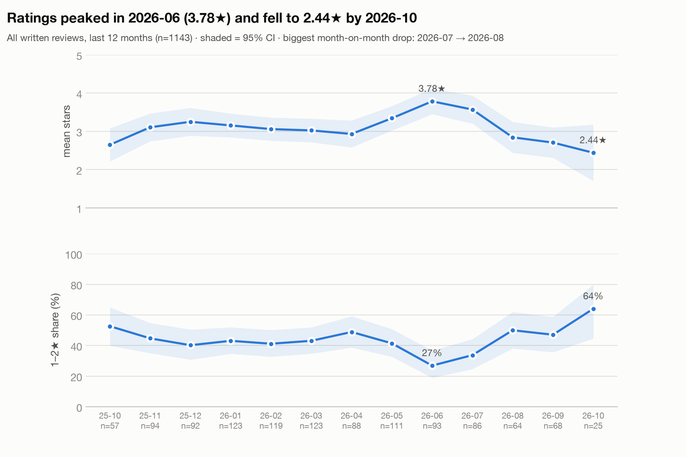

| Month | Average rating | 1–2★ share | Reviews |
|---|---|---|---|
| Jun 2026 (peak) | 3.78★ | 27% | |
| Jul 2026 | 3.57★ | | |
| Aug 2026 | 2.84★ | 50% | 64 |
| Sep 2026 | 2.71★ | 47% | 68 |
| Oct 2026 (to the 12th) | 2.44★ | 64% | 25 |

The App Store gives no app version per review, so this report cannot link the drop to a release. The
themes that rose in the same period (section 5) show where to look.

*The listing's 4.78★ and the written reviews' 3.13★ measure different things.* The listing also
counts star-only ratings, for example from in-app rating prompts, while people with a problem are the
ones who write. Read every share in this report as "what reviewers say".

## 2. Stars vs text: where complaints hide

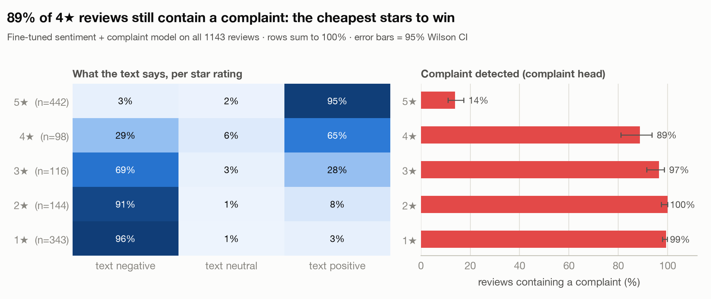

The fine-tuned sentiment model reads the text, and a separate head flags complaints.

| Stars | Text reads negative | Contains a complaint |
|---|---|---|
| 3★ | 69% | 97% |
| 4★ | 29% | 89% |
| 5★ | | 14% |

Star averages therefore under-count fixable problems. The theme analysis below works at the sentence
level, so it catches the complaint inside "Love Notion, but the app is so buggy" (1★).

## 3. What users talk about

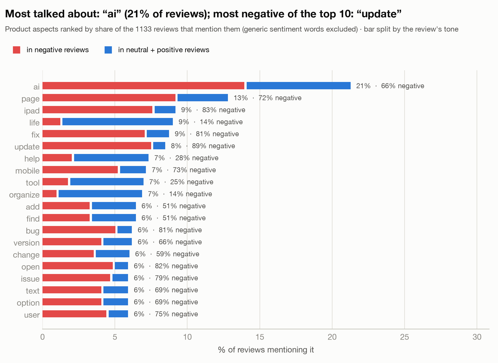

These are the most-mentioned product aspects, a quantitative replacement for a word cloud.

| Aspect | Share of reviews | Of which negative |
|---|---|---|
| AI | 21% | 66% |
| page | 13% | 70% |
| iPad | 9% | 84% |
| update | 8% | 88% |
| mobile | 7% | 73% |
| "life", "organize" | | only 14% |

The aspects mentioned in a positive tone describe what the product does for people ("organise my
life").

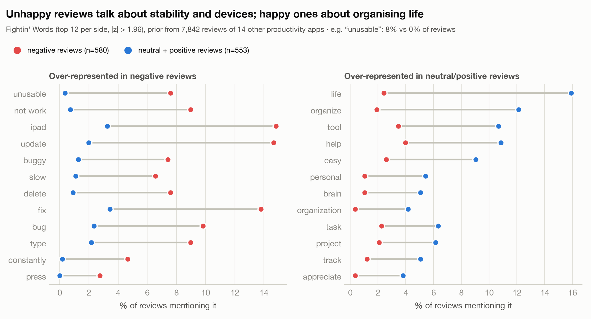

**Keywords and phrases in negative reviews** (Fightin' Words: log-odds with an informative prior from
8,153 reviews of 14 other productivity apps). Generic sentiment words such as "terrible" are
filtered out, so what remains are product aspects:

| Phrase | Negative reviews | Other reviews |
|---|---|---|
| unusable | 8% | 0% |
| not work | 9% | 1% |
| iPad | 15% | 3% |
| update | 14% | 2% |
| buggy | 7% | 1% |
| slow | 7% | 1% |
| delete | 8% | 1% |
| bug | 10% | 2% |
| type | 9% | 2% |

Positive reviews instead stand out for *life, organize, tool, help, easy, personal, brain*.

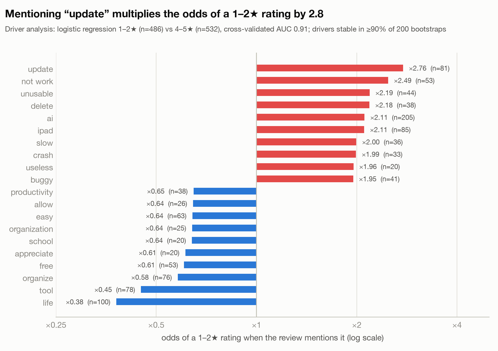

**Rating drivers.** A logistic regression of 1–2★ vs 4–5★ reviews on the phrases, with a
cross-validated AUC of 0.91. Only phrases whose sign is stable in ≥ 90% of 200 bootstraps are kept.

These phrases multiply the odds of a low rating:

| Phrase | Odds of a 1–2★ rating |
|---|---|
| update | ×3.7 |
| not work | ×3.4 |
| unusable | ×2.9 |
| delete | ×2.8 |
| useless | ×2.7 |
| money | ×2.7 |
| slow | ×2.7 |
| crash | ×2.6 |
| AI (205 reviews) | ×2.5 |
| iPad | ×2.5 |

These go with high ratings: *life* (×0.31), *tool* (×0.37), *free*, *organize*.

They are associations, not causes, but they point the same way as the themes.

## 4. Themes: what hurts and what works

Themes come from the sentences, not the stars. A human-approved taxonomy of **17 complaint** and **8
praise** themes was built from these reviews with the TopicGPT method:
- an LLM extracted aspects;
- a second LLM consolidated them;
- a human reviewed and edited the draft.

Every sentence was then tagged. **92%** of reviews have at least one theme. A spot-check of 30 tagged
sentences found 27 correct and 3 partly correct; the verdicts are AI-reviewed and confirmed by a
human.


**How to read the chart:** x = share of reviews that mention the theme. y = **rating impact**, how many
stars those reviews average below the rest (the Artefact method, with a Welch 95% CI). Bottom-right is
frequent *and* severe.

| Complaint theme | Reviews | Rating impact [95% CI] | Priority |
|---|---|---|---|
| App stability & crashes | 14.3% | −1.27 [−1.48, −1.06] | **0.181** |
| AI forced / intrusive | 10.2% | −1.39 [−1.62, −1.15] | **0.142** |
| iPhone / mobile app experience | 11.5% | −1.17 [−1.41, −0.93] | **0.135** |
| UI / UX & usability | 11.3% | −1.12 [−1.36, −0.88] | **0.126** |
| iPad-specific issues | 8.9% | −1.29 [−1.52, −1.05] | **0.115** |
| Updates & compatibility | 7.2% | −1.56 [−1.79, −1.33] | 0.112 |
| Performance & loading speed | 8.4% | −1.26 [−1.50, −1.01] | 0.106 |
| Typing & text editing | 6.5% | −1.33 [−1.59, −1.06] | 0.086 |
| Missing features & feature bugs | 12.3% | −0.63 [−0.89, −0.37] | 0.078 |
| Pricing & subscriptions | 6.0% | −1.10 [−1.47, −0.73] | 0.066 |
| Learning curve & onboarding | 5.7% | +0.07 [−0.38, +0.52] | – |

The table omits smaller themes (AI quality 4.5%, data loss 2.8%, support 2.4%, account 2.0%, sync
1.8%, localisation 0.5%).

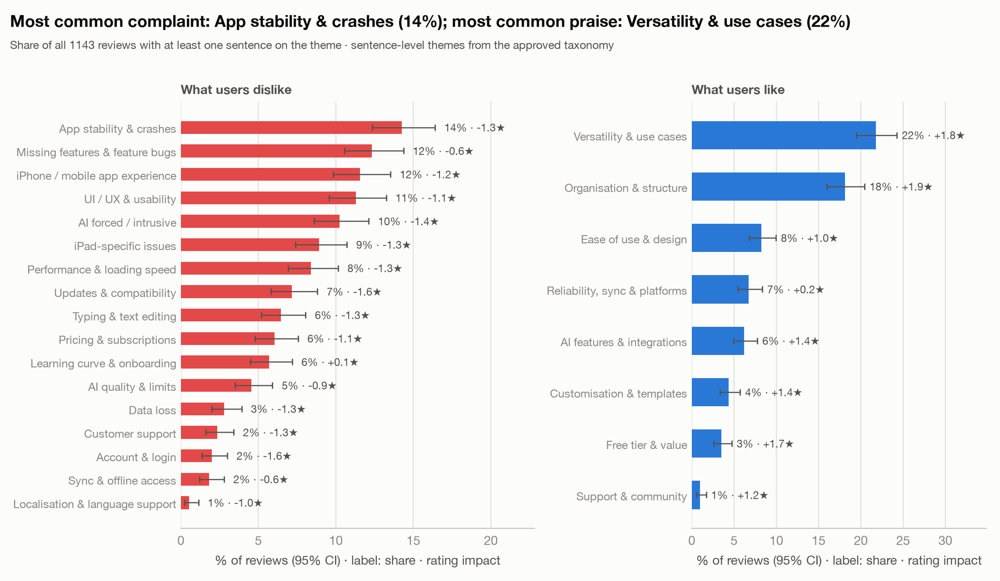

| Praise theme | Reviews | Rating impact |
|---|---|---|
| Versatility & use cases | 21.8% | +1.78★ |
| Organisation & structure | 18.1% | +1.86★ |
| Ease of use & design | 8.2% | +1.01★ |
| AI features & integrations | 6.2% | +1.37★ |
| Free tier & value | 3.5% | +1.68★ |

AI appears on both sides: 6% of reviews praise it and 10% complain that it is forced on them. The
the point is that users want control over it, not that AI is unwelcome.

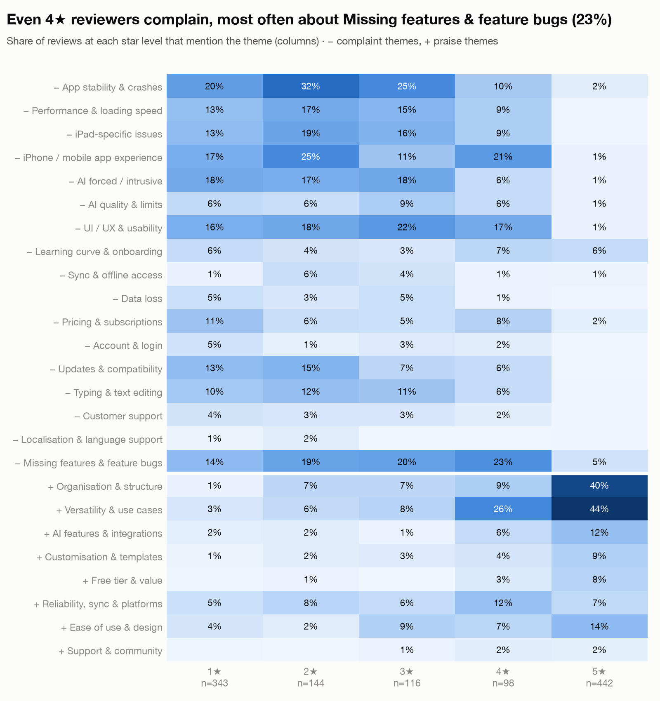

Complaint themes appear even in 4★ reviews:

| Complaint theme | Share of 4★ reviews |
|---|---|
| Missing features & feature bugs | 23% |
| iPhone / mobile app experience | 21% |
| UI / UX & usability | 17% |

These users already like the product, so they are the cheapest to win back.

## 5. What changed recently

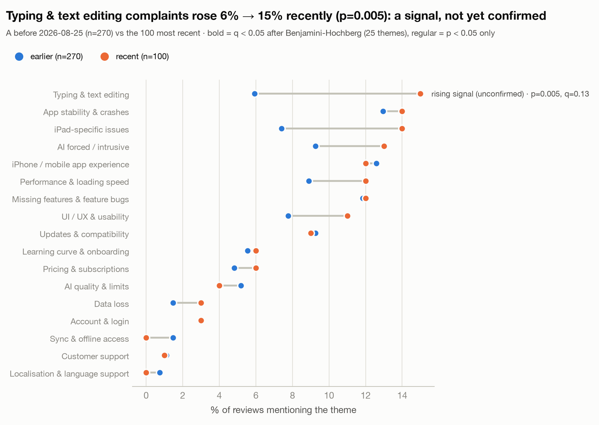

The pre-registered comparison is **B** (the 100 newest reviews, from 2026-08-25) against the **270
earlier reviews of sample A**. It uses two-proportion tests with Benjamini–Hochberg correction across
all 25 themes.
- **Typing & text editing: 5.9% → 15.0%** (p = 0.005, q = 0.13). That is a rising signal, not yet
  significant after correction with n = 270 vs 100.
- **Robustness check:** against all 1,043 earlier reviews in the pool instead of the 270, the same
  rise (5.7% → 15.0%) is **confirmed (q = 0.01)**.
- iPad-specific issues: 7.4% → 14.0% (p = 0.05). This one is not significant after correction.

Phrases that rose without any taxonomy (the drift monitor, pool base):

| Phrase | Earlier | Recent |
|---|---|---|
| iPad | 9% | 16% |
| text | 5% | 11% |
| add | 6% | 10% |
| upgrade | 1% | 4% |

That is consistent with the typing and iPad findings.

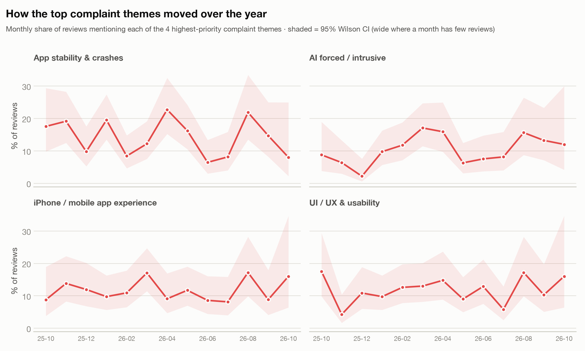

## 6. Areas of improvement

The problem areas are ranked by priority = share of reviews × rating drag. The ranking shows **where**
the problems are and how big they are; what to do about them is for the product team. Each area is
backed by verbatim quotes.

1. **App stability & crashes.** 14% of reviews (95% CI 12–16%) mention it, and they average 2.0★, 1.3★
   below the rest.
   > "I love Notion, but *all the time* I find myself trying to update a field on a table and the app
   > just won't let me type, exit the page, or do anything except select." (3★)

   > "Love Notion, but the app is so buggy." (1★)
2. **AI forced / intrusive.** 10% of reviews (9–12%), averaging 1.9★, 1.4★ below the rest.
   > "Notion is amazing but I hate ai and it is so hard to work around please make options for us
   > available." (2★)

   > "Good... but the AI features have ruined it." (3★)
3. **iPhone / mobile app experience.** 12% of reviews (10–14%), averaging 2.1★, 1.2★ below the rest.
   > "The overall trajectory of the platform has been great since then, but the mobile app has always
   > had issues." (1★)
4. **UI / UX & usability.** 11% of reviews (10–13%), averaging 2.1★, 1.1★ below the rest.
   > "The three-dots at the top right of each image was always very useful to quickly use other
   > options such as captioning, but now its gone." (4★)
5. **iPad-specific issues.** 9% of reviews (7–11%), averaging 2.0★, 1.3★ below the rest. This theme is
   also rising (7% → 14%).
   > "The overall and features work great however when using with a appropriate IPad and Keyboard
   > with trackpad doesn't seem to work and makes this super unproductive." (2★)

**Also worth a look:**
- **Typing & text editing**, the emerging area (6% → 15%):
  > "Its a good app besides the ai slop but its got this recurring bug where if you highlight
  > multiple lines of text and try to delete it it doesnt delete, making you manually hold delete."
- **Updates & compatibility**, the strongest drag at −1.6★:
  > "I love this app but your last update made it super glitch"
- **Developer replies.** Notion answered 1 of 1,143 reviews.

## 7. Drift monitor: what the themes do not cover

**17%** of complaint sentences fit no theme. They are mostly generic ("please fix this", "frustrating",
"I've been using it for years") and add no new product issue. That is the expected state right after a
taxonomy is built.

The monitor reports two signals:
- a rising unassigned share, or a new recurring word among those sentences;
- phrases that rise against the earlier period (section 5).

Either one is the trigger to refresh the taxonomy. The refresh process is in the README.

## 8. Method and caveats

- **Sentiment.** Fine-tuned RoBERTa (English) and XLM-R (other languages), distilled from two
  open-weight LLM annotators on 6,796 reviews of other apps.
  - On 100 human-labelled Notion reviews: macro-F1 0.78, accuracy 0.89, negative recall 0.95 and
    precision 0.92, complaint F1 0.96.
  - A review is negative if P(negative) ≥ 0.30, because missing a negative review costs more than a
    false alarm. See the README for the full model comparison.

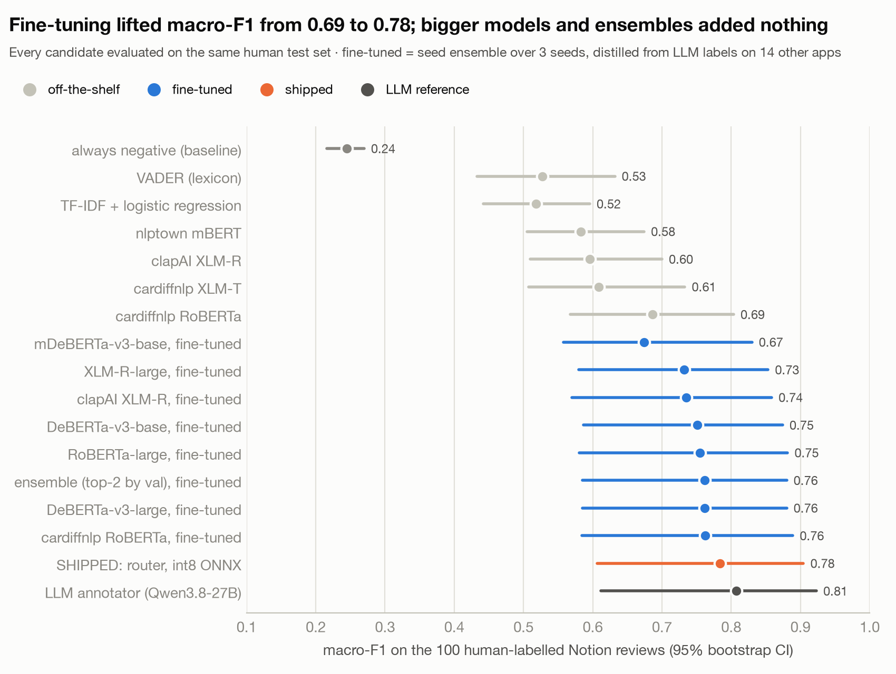

- **Uncertainty.** Shares carry Wilson 95% intervals. The mean rating uses a t-interval, with the
  finite-population correction for the random sample. Theme changes are corrected for multiple tests
  (Benjamini–Hochberg).
- **Who writes reviews.** Written reviews are not all users, and they over-represent problems.
  Storefronts are English-speaking. The 3% non-English reviews were machine-translated for the
  phrase analysis.
- **Associations, not causes.** Rating impact and drivers compare reviews that mention a topic with
  reviews that don't. The App Store gives no version per review, so releases cannot be linked to
  changes in ratings.
- **Data source.** The apps.apple.com web reviews endpoint, collected politely with ≥ 3 s between
  requests and backoff on HTTP 429. Its `robots.txt` disallows `/api/`, so this collection is for
  research and assessment only. The snapshot is committed so the analysis is reproducible without
  calling Apple again.

## Appendix: the same API on a new app (Nebula, live run)

To check that the system works on any app, the API collected **Nebula: Spiritual Guidance**
(1459969523) live on 2026-10-14:

```
POST /v1/apps/1459969523/collections   {"count": 100, "window_days": 90, "storefronts": ["us", "gb"]}
```

- **The run.** The job downloaded all **466** written reviews from the last 90 days (26 pages in 5.5
  minutes, under Apple's throttling). It then drew **100 random reviews** and analysed both. The
  results are committed as `data/snapshots/nebula_2026-10-14`, with HTML reports in `docs/`.
- **No themes.** The theme taxonomy covers Notion only, so the theme step was skipped. The insights
  are taxonomy-free.
- **Ratings.** **4.31★** [4.19, 4.43] against a listing of 4.57★: 72% 5★, 12% 1★. 15% of reviews read
  negative, and 21% contain a complaint.
- **What unhappy users talk about is money.**

  | Phrase | Negative reviews | Other reviews |
  |---|---|---|
  | money | 33% | 1% |
  | pay | 35% | 1% |
  | subscription | 23% | 1% |
  | charge | 20% | 0% |
  | account | 16% | 0% |

  The rating-driver model agrees (AUC 0.93; *money* goes with ×1.8 the odds of a 1–2★ rating).
  Quotes:
  > "They say that you can pay a pound for a reading and then they're taking an extra 15 quid without
  > your knowledge." (1★)

  > "I do not have an active subscription with these people but they have been taking $66 dollars per
  > month from my Amex card, beware." (1★)

  > "I have reached out numerous times after I was put in a waiting room, and charged $20 in reading
  > time to wait - with no reading." (1★)
- **The 100-review sample alone points the same way.** It has only 14 negative reviews, too few for
  the significance test, so the API falls back to plain counts and labels them as such: *money* and
  *pay* each appear in 5 of the 14 negative reviews, and *charge*, *refund* and *subscription* in 3.
- **Reading.** The quotes share one thread: charges users did not expect, and refunds or
  cancellations that are hard to get. Billing is the first area worth a closer look. A theme
  taxonomy for Nebula would turn these phrases into named themes; the process is in the README.
